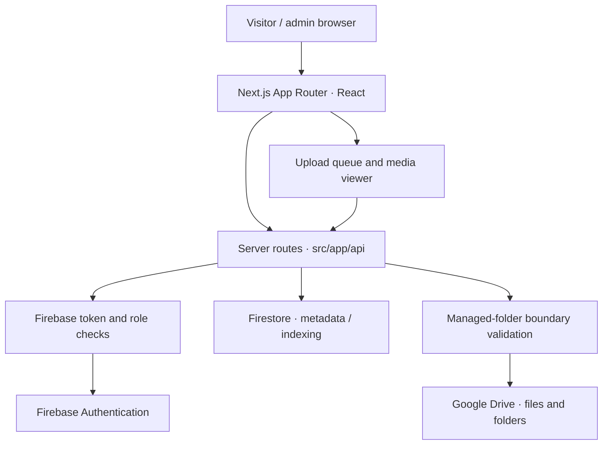

# GMAHK Galilea Digital Archive

**A Sabbath-centered media and document archive for the GMAHK Galilea congregation in Balikpapan.**

The application connects a public archive browser and managed upload workflow to Google Drive. Firebase provides identity and indexed metadata; Next.js serves the visitor experience and server-side API routes.

[Open the archive](https://drive-galilea.vercel.app/) · [Architecture](docs/ARCHITECTURE.md) · [Setup guide](docs/GOOGLE_SETUP.md)

[](https://github.com/zvenians/gmahk-galilea-digital-archive/actions/workflows/ci.yml)

---

## Overview

Church media is often spread across messaging threads, personal drives, and individual devices. Finding last quarter's bulletin or media from a particular Sabbath can become difficult even when the original files still exist.

Digital Archive organizes those files around how the congregation uses them: **year → quarter → Sabbath date**, with separate managed areas for service documentation and worship resources. It also supports authorized administration without requiring every visitor to navigate the underlying Drive account.

### Main workflows

| Workflow | What happens |
| --- | --- |
| **Explore** | Browse a Sabbath-oriented archive tree and open individual records |
| **Preview** | View supported images, video, and documents through application endpoints |
| **Download and share** | Download original files or share application links |
| **Upload** | Submit files through a multi-file queue with measured upload progress and retry paths |
| **Administer** | Review activities, logs, automation, reconciliation, and file trash actions with server-side authorization |

Access to particular operations is controlled by the application's routes and role checks. A visible control alone is not proof of authorization.

## Architecture



**Storage responsibility:** Google Drive holds the original files. Firestore holds metadata and application records; it is not a replacement for Drive binary storage.

**Managed storage:** archive operations are intended to remain within the configured `Dokumentasi` and `File Ibadah` folder trees. Authorization, file membership, and parent traversal must be retested when storage handlers change.

**Time model:** the Sabbath and quarter utilities use `Asia/Makassar` (WITA, UTC+8) for congregation-specific date behavior.

### Conceptual folder model

```text
GMAHK Galilea/
├── Dokumentasi/
│   └── <year>/
│       └── Triwulan I–IV/
│           └── <Sabbath date>/
└── File Ibadah/
    └── <year>/
        └── Triwulan I–IV/
            └── <Sabbath date>/
```

The example represents the organizing convention, not a guarantee that every date's folder already exists.

## Features in the source

### Archive and media

- Sabbath-oriented navigation, archive tree discovery, and date-specific browsing.
- Viewer routes for images, media, and supported documents.
- Download routes, application share links, and file metadata handling.
- Thumbnail endpoints that fetch media through the server rather than exposing OAuth credentials.
- Firestore-backed indexing and selected-media discovery on the homepage.

### Uploads and file lifecycle

- XHR upload progress based on bytes transferred, with a queue limited to three simultaneous uploads.
- Per-file error states, retry controls, filename collision handling, and active-upload navigation protection.
- Resumable upload and upload-session helpers in `src/lib/`.
- File deletion routed to Google Drive trash through an admin API, rather than presented as anonymous permanent deletion.

### Administration

- Google sign-in and Firebase session context.
- Server-side admin authorization on restricted endpoints.
- Activities, logs, automation controls, reconciliation, and trash actions.
- Feedback states for failed network and authentication operations.

## Technology

| Layer | Implemented technologies |
| --- | --- |
| Frontend | Next.js 16.3.4, React 19, TypeScript 5 |
| Styling | Tailwind CSS 4, CSS Modules, Lucide React |
| Server | Next.js App Router and route handlers |
| File storage | Google Drive API v3 using `googleapis` |
| Identity and metadata | Firebase Authentication, Firebase Admin, Cloud Firestore |
| Test tooling | Node.js test runner, `tsx`, ESLint |
| Hosting | Vercel deployment configuration |

Dependencies and scripts are defined in [`package.json`](package.json). Version numbers should be updated when the dependency manifest changes.

## Project layout

```text
.
├── src/
│   ├── app/
│   │   ├── admin/                  Administrative workspace
│   │   ├── api/
│   │   │   ├── admin/              Restricted operations
│   │   │   ├── archive/            Tree, media, thumbnail, download
│   │   │   ├── upload/             File submission
│   │   │   └── sabbath/            Calendar data
│   │   ├── archive/                Archive browsing
│   │   ├── upload/                 Multi-file upload
│   │   ├── login/                  Google sign-in
│   │   └── page.tsx                Homepage
│   ├── components/
│   │   ├── archive/                Archive UI and layout modules
│   │   ├── MediaViewer.tsx         Media interaction
│   │   └── Navbar.tsx / Footer.tsx Navigation
│   ├── context/                    Auth and notification state
│   └── lib/                        Drive, Firestore, auth, time, uploads
├── scripts/                        OAuth and Drive administration tools
├── test/                           Security, upload, calendar, and UI tests
├── docs/                           Architecture and operations reference
├── .env.example                    Configuration inventory (no live secrets)
└── package.json
```

## Local setup

**Prerequisites:** Node.js 20+ (Node.js 24 used by current CI), npm, and an authorized Google Cloud/Firebase project for connected features.

```bash
git clone https://github.com/zvenians/gmahk-galilea-digital-archive.git
cd gmahk-galilea-digital-archive
npm ci
cp .env.example .env.local
npm run dev
```

The development server uses the normal Next.js localhost address, typically `http://localhost:3000`. Fill `.env.local` only with credentials for a project you control. Without a correctly configured Google Drive and Firebase connection, UI pages may load but connected operations will not function.

### Configuration reference

| Variables | Responsibility | Browser exposure |
| --- | --- | --- |
| `NEXT_PUBLIC_FIREBASE_*` | Firebase browser application configuration | Intended to be public |
| `FIREBASE_PROJECT_ID`, `FIREBASE_CLIENT_EMAIL`, `FIREBASE_PRIVATE_KEY` | Server-side Firebase Admin identity | **Never expose** |
| `GOOGLE_CLIENT_ID`, `GOOGLE_CLIENT_SECRET`, `GOOGLE_DRIVE_REFRESH_TOKEN` | Drive OAuth client and authorization | **Server only** |
| `GOOGLE_DRIVE_ROOT_FOLDER_ID` | Root boundary of the managed Drive collection | Server |
| `GOOGLE_DRIVE_DOKUMENTASI_FOLDER_ID` | Documentation subtree | Server |
| `GOOGLE_DRIVE_FILE_IBADAH_FOLDER_ID` | Worship-file subtree | Server |
| `SUPER_ADMIN_EMAIL` | Administrative identity configuration | Server |
| `NEXT_PUBLIC_SUPER_ADMIN_EMAIL` | Public UI reference; **not** an authorization mechanism | Public |
| `UPLOAD_SESSION_SECRET` | Server-side signing of upload session state | **Never expose** |

Use [`.env.example`](.env.example) as the complete source of configuration keys. Browser-exposed Firebase configuration is distinct from privileged Firebase Admin credentials.

If Drive OAuth authorization expires or is revoked, follow the [Google setup and re-authorization guide](docs/GOOGLE_SETUP.md). Do not place tokens in issues, commits, browser logs, or chat messages.

## Development and verification

```bash
npm run lint
npm run test
npm run build
```

The test suite covers upload-session behavior, OAuth feedback, token and role security, Sabbath-date handling, thumbnails, viewer layout utilities, and regression scenarios. The [CI workflow](.github/workflows/ci.yml) runs repository checks on pull requests.

The build validates compilation; it does not establish that an actual production Google account or all Drive permissions are correctly configured.

### Optional administrative scripts

```bash
npm run drive:connect
npm run drive:bootstrap
```

These scripts are for authorized environment setup. They may request Google permissions or create managed folders. **Do not execute them against a production account during ordinary frontend testing.**

## API and permissions

Public browsing, file submission, and restricted administrative actions use separate route handlers. A valid Firebase client state is not sufficient to authorize restricted server operations. Admin endpoints verify identity and role on the server, and managed file operations check their configured folder boundaries.

The upload queue can fail independently for one file. Clients should show a meaningful per-file error rather than treating the whole batch as successful. Media APIs and thumbnail responses may use caching; cached results should not be mistaken for fresh Drive state.

### Operational boundaries

- File visibility and sharing remain subject to Google Drive access and application authorization.
- Firestore indexes may lag behind recent Drive changes until reconciliation.
- Browser progress reflects transferred bytes; final server-side processing can continue after transfer completes.
- Trash operations are reversible according to Drive retention rules; do not describe them as permanent deletion.
- No statement here guarantees zero data loss, a measured performance improvement, or a security certification.

## Release process

1. Work on a separate branch and open a pull request.
2. Run lint, tests, and build; inspect errors without production credentials.
3. Review changes to Drive folder membership, admin roles, upload sessions, and deletion paths carefully.
4. Verify the intended Vercel project and environment before an approved release.
5. After release, smoke-test browsing, thumbnails, uploads, download, and admin denial paths with authorized test accounts.

Do not assume that a GitHub push grants permission to change the live archive.

## Reference material

- [Architecture and data model](docs/ARCHITECTURE.md)
- [Google Drive, OAuth, and Firebase setup](docs/GOOGLE_SETUP.md)
- [Contribution guide](.github/CONTRIBUTING.md)
- [CI checks](.github/workflows/ci.yml)

---

**A ministry archive built for practical retrieval and accountable administration.** Maintained in the [@zvenians](https://github.com/zvenians) workspace.
